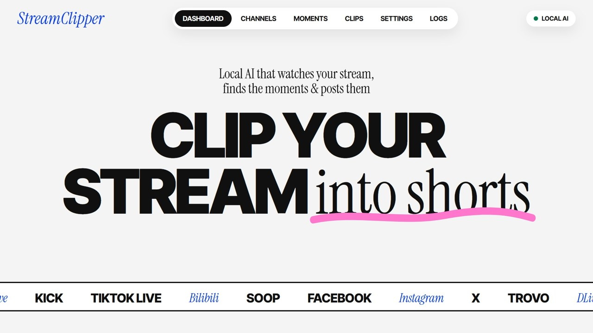

# StreamClipper

[](https://github.com/jebarson-caleb/streamclipper/actions/workflows/ci.yml)
[](LICENSE)

[](docs/media/streamclipper-demo.mp4)

▶ **Watch the 20-second demo:** [16:9](docs/media/streamclipper-demo.mp4) · [9:16 vertical](docs/media/streamclipper-demo-vertical.mp4)

StreamClipper runs in the background on your PC and does the following:

- watches live streams from **any platform**: paste a link and it works out how to capture it,
- finds the good moments using a **local LLM** (Ollama) plus audio, chat and scene signals,
- cuts each moment into a **Short (9:16)** or a **long 16:9 video**, with animated word-by-word subtitles,
- **schedules uploads to YouTube** in release slots, with no human steps.

It is built for a 4 GB GPU such as an RTX 3050: Whisper `small` int8 and a 3B Q4 LLM take turns on the GPU.

## Install (Windows)

1. Download **`StreamClipper-Setup-<version>.exe`** from the [latest release](https://github.com/jebarson-caleb/streamclipper/releases/latest).
2. Run it. It installs for your user only (no admin prompt) and adds Start-menu and desktop shortcuts.
3. StreamClipper opens with a **setup guide**. While you read it, the app downloads its AI models once (about 2.5 GB):
   1. **Getting the AI ready**: video engine, AI model and speech model, each with a live status.
   2. **YouTube (optional)**: pick your Google OAuth client file and click Connect.
   3. **Your first stream**: paste a live link and click Start clipping.

That's it: ffmpeg and the AI engine ([llama.cpp](https://github.com/ggml-org/llama.cpp)) are bundled inside the app, so nothing else gets installed.
The AI runs on any NVIDIA, AMD or Intel GPU through Vulkan, or on the CPU.

Windows may show a SmartScreen warning because the installer isn't code-signed yet: click **More info → Run anyway**. On PCs with **Smart App Control** turned on, Windows may block the unsigned installer outright until it's signed.
Closing the window stops the pipeline. Reopen the guide any time from **Settings**. Your settings and clips live in `%LOCALAPPDATA%\Programs\StreamClipper`.

**Requirements:** Windows 10/11 64-bit, about 4 GB free disk for the app and models plus space for recordings. A GPU with 4 GB is enough; none is required.

## Quick start (from source)

From source you need Python 3.11, [ffmpeg](https://www.gyan.dev/ffmpeg/builds/) and [Ollama](https://ollama.com) (`scripts\setup.ps1` installs all three). Set `llm.backend: llamacpp` in `config.yaml` to use the llama.cpp engine instead (run `scripts\fetch_vendor.ps1` first).


1. Double-click **StreamClipper** on your Desktop (or `StreamClipper.bat`). The dashboard opens at http://127.0.0.1:8765.
   On first run, the .bat installs everything automatically. Ollama and the LLM model also start or download on their own.
2. Paste a live link in **"Paste a live link"**, choose **Whose stream?**, a mode and an output, then click **▶ Start clipping**.
3. To post to YouTube, connect your account under **Settings**. Until you do, clips are rendered and wait in **Clips & queue**.

Adding a link from a terminal does the same thing (the app must be running):
```powershell
.\.venv\Scripts\python.exe -m streamclipper add "https://kick.com/yourname" --permission own --mode hybrid --outputs both
```

### Which links work
| Link | How it is captured |
|---|---|
| Twitch, YouTube Live, Kick, TikTok Live, Bilibili, SOOP/AfreecaTV, Huya, Douyu, Trovo, DLive, Picarto… | streamlink |
| Any other site with a live player: Facebook, Instagram, X, Rumble, Dailymotion, news sites, … (1800+ sites) | yt-dlp, used automatically when streamlink has no plugin |
| Raw `.m3u8` / `.mpd` / `.flv` URLs, `rtmp://`, `rtsp://`, `srt://` | ffmpeg directly |
| A recorded video or past broadcast link (not live) | downloaded once with yt-dlp and clipped like a VOD |
| A local video file path | processed directly |

Live chat signals (message rate, emotes, `!clip`) are read on Twitch and YouTube. On every other platform, moments are found from audio, scene changes and the transcript.
Some sites block automated access: Rumble returned 403 even with browser impersonation. The dashboard shows the reason next to the channel.

## How it works

```
monitor ─▶ recorder (streamlink → ffmpeg 30 s segments)
              │
              ├─▶ signals: loudness · scene cuts · chat rate · emote/keyword bursts · mod "!clip"
              ├─▶ faster-whisper transcript with word timestamps
              ▼
         hype curve ─▶ candidate windows ─▶ local LLM judge (score, trim, title, hook)
              ▼
   mode: best_moments | continuous | hybrid   +  dedupe
              ▼
   render: face-tracked 9:16 crop / facecam split / blur-fit · karaoke subs · hook card
           progress bar · credit · loudness normalize · NVENC
              ▼
   metadata (LLM title/description/tags/chapters) ─▶ YouTube upload as private + publishAt
```

Each stage is a status in SQLite. If the PC crashes or reboots, the tool resumes where it stopped.

## Modes

| Mode | Shorts output | Long output | Both |
|---|---|---|---|
| **best_moments** | one Short per moment above the threshold | compilation of the top moments, with chapters, at stream end | both |
| **continuous** | the whole stream cut into back-to-back ~55 s Shorts | the whole stream cut into 10-minute parts | both |
| **hybrid** | best moments become Shorts, and the whole stream also goes up as long parts | | |

## Features
- **Permission guard**: each channel must be marked `own` or `allowed` (with a proof note), otherwise it is never clipped. Allowlisted creators get an automatic on-screen and description credit.
- **Manual triggers**: a dashboard "✂ Clip last 60s" button, and a `!clip` command typed in chat by mods or the broadcaster.
- **Smart vertical layout**: sports, gameplay and IRL get an **action-tracking 9:16 crop**. It follows where the motion is, glides within a shot, and can jump at a cut. Just Chatting gets a face-centred crop, but only for a real talking head, never a bystander. A webcam fixed in a corner gets facecam on top and gameplay below. If the action is too spread out to fit 9:16, the tool uses a blurred-background fit.
- **Proper start and finish**: clip edges snap to the video's own shot changes. A clip starts where the shot of the setup starts and ends before the next item's intro or title card. A frozen end card, logo or black screen is trimmed off. On single-camera streams, edges snap to whole sentences instead. Short fades in and out give compilations dip-to-black transitions.
- **Honest scoring**: the final score is the LLM's rating plus a bonus for strong hype, so threshold 7 means "the LLM rates it 7". Windows with no speech and no chat are scored on hype alone instead of an LLM guess. When a stream ends, a second pass re-checks borderline peaks.
- **Clean transcripts**: Whisper runs without its voice filter, which drops commentary over loud crowds. A filter calibrated on real data removes the text Whisper invents over music. It keeps Japanese, Hindi, Russian, Korean and mixed-language speech.
- **Release scheduling**: you set the slots per format (for example 11:00, 15:00, 19:00, 22:00) and a daily cap. The tool tracks YouTube quota, which resets at midnight Pacific.
- **Review mode** (optional): clips wait until you click Approve.
- **Caption tracks**: SRT files, with optional LLM translation and caption upload.
- **Analytics feedback loop**: view counts adjust how future clips are scored per category (0.8x to 1.2x).
- **Notifications**: Discord and Telegram, for live started, clip ready, uploaded, and errors.
- **Housekeeping**: a retention policy for raw segments and renders, a health panel (GPU, disk, LLM, quota), and auto-restart of crashed loops.

## Setup (Windows)

```powershell
powershell -ExecutionPolicy Bypass -File scripts\setup.ps1
```
This installs Python 3.11, ffmpeg and Ollama through winget, creates `.venv`, installs the dependencies and CUDA DLLs, and pulls `qwen2.5:3b-instruct-q4_K_M`.

**YouTube API**:
1. Create a Google Cloud project and enable **YouTube Data API v3**.
2. Set up the OAuth consent screen and add yourself as a test user.
3. Create an OAuth client ID of type **Desktop app** and save the JSON as `client_secret.json` in this folder.
4. In the dashboard, go to **Settings → Connect**.

> Until Google audits your API project, uploads are locked to *private*. The default quota (10,000 units/day) allows about 6 uploads/day. To make scheduled public releases work, request an audit or quota increase.

## Run

```powershell
.\.venv\Scripts\python.exe -m streamclipper desktop      # dashboard in its own app window (Edge or Chrome)
.\.venv\Scripts\python.exe -m streamclipper run          # dashboard at http://127.0.0.1:8765
.\.venv\Scripts\python.exe -m streamclipper process-file my_vod.mp4 --mode best_moments --outputs both   # offline test, no upload
powershell -ExecutionPolicy Bypass -File scripts\install_service.ps1   # start hidden at every logon
```

Settings live in `config.yaml`; `config.example.yaml` documents every key.

## Live streams
- Live streams are clipped **continuously while live**. They're analysed in 20 s chunks and checked every 15 s, and they always go ahead of any recorded videos waiting in the queue. On a test broadcast, a finished Short was ready about 30 s after the moment happened.
- Signal loss, BRB screens and paused streams (frozen *and* silent) are never turned into clips.
- When a stream ends, the recorder stops cleanly. HLS streams are recognised as ended by `#EXT-X-ENDLIST`, and repeated empty restarts back off and then stop.
- Disk guard: below `capture.min_free_gb` (5 GB) no new recordings start, and below half of that active recordings stop. You're notified either way.

## Quality check
After rendering, grade every clip automatically:
```powershell
.\.venv\Scripts\python.exe scripts\qa.py config.yaml
```
It checks format (1080×1920 / 1920×1080, 30 fps, Short length), clean start and finish (not black, not frozen), camera smoothness, loudness (−14 LUFS) and clipping, subtitle timing, title/tags/credit, and the long video's chapters and thumbnail.

## Tests
```powershell
.\.venv\Scripts\python.exe -m pip install -e ".[dev]"
.\.venv\Scripts\python.exe -m pytest
```

## Build the installer

One command builds `dist\StreamClipper-Setup-<version>.exe`:
```powershell
powershell -ExecutionPolicy Bypass -File scripts\build.ps1          # needs Inno Setup: winget install JRSoftware.InnoSetup
powershell -ExecutionPolicy Bypass -File scripts\build.ps1 -Cuda    # also bundle NVIDIA cuBLAS/cuDNN for GPU Whisper (~2 GB more)
```
It downloads the pinned tools into `vendor\` ([`scripts/fetch_vendor.ps1`](scripts/fetch_vendor.ps1), SHA-256 checked), assembles the install folder in `build\app` and packs it with Inno Setup ([`packaging/installer.iss`](packaging/installer.iss)).

The app runs on the **official, signed Python runtime** from python.org rather than a self-built exe. Windows Smart App Control blocks unsigned programs it hasn't seen before, and those programs can't load unsigned libraries either; with the signed Python as the host, the app's libraries load normally. Only the installer itself is unsigned (see [Known limits](#known-limits)).

Bundled third-party tools: Python 3.11 embeddable (PSF license), ffmpeg ([GyanD build](https://github.com/GyanD/codexffmpeg), GPLv3, license in `vendor\ffmpeg\LICENSE`), llama.cpp (MIT) and deno (MIT). The AI model is [Qwen2.5-3B-Instruct GGUF](https://huggingface.co/Qwen/Qwen2.5-3B-Instruct-GGUF), downloaded from Hugging Face on first launch under its own license.

### Releases
Push a version tag and GitHub Actions builds the installer and attaches it to a release:
```powershell
git tag v0.2.0
git push origin v0.2.0
```
CI runs the tests on every push to `main` and on pull requests.

## Project layout
```
streamclipper/      the app
  capture/          recorder (streamlink / yt-dlp / ffmpeg → 30 s segments)
  monitor/          live checks and platform detection
  signals/          audio, scene and chat signals
  transcribe/       faster-whisper
  detect/           hype curve, candidates, LLM judge, modes, dedupe
  edit/             vertical crop, tracking, subtitles, render, thumbnails
  publish/          YouTube auth, metadata, scheduler, uploader, analytics
  web/              FastAPI + HTMX dashboard
  main.py           CLI: run | desktop | add | auth | process-file
packaging/          Inno Setup script, icon
scripts/            setup, build, service install, QA
tests/              pytest suite
```

## Contributing
Issues and pull requests are welcome. Run `pytest` before opening a PR.
Only clip streams you own or have the creator's permission to clip; the permission guard is there on purpose.

## License
[MIT](LICENSE)

## Known limits
- GPU video encoding (NVENC) needs an NVIDIA driver new enough for your ffmpeg build. ffmpeg 9.x needs driver 610 or newer. With an older driver, rendering falls back to the CPU (libx264): it still works, just slower.
- Best-moment compilations can only use footage still inside `capture.buffer_hours` (6 h by default). Raise it if you stream longer and want full-stream compilations.
- The installer isn't code-signed yet. SmartScreen warns about it, and PCs with Smart App Control enforcing may block it. Signing it (for example through the free [SignPath Foundation](https://signpath.org) program for open-source projects) removes both.
- Background-music detection (to avoid Content ID claims) is not implemented. Mute game or stream music yourself, or use `review_mode`.
- Chat offsets are wall-clock based. HLS latency (~5-10 s) roughly cancels out viewer reaction delay.
